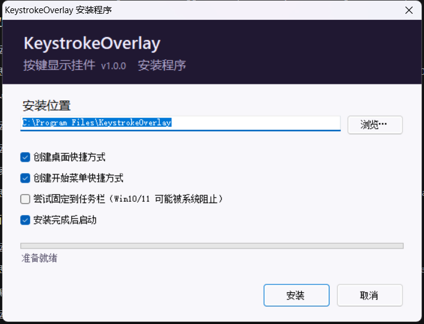

# KeystrokeOverlay — 按键显示挂件 v8

给直播 / 录屏用的按键显示。双击 `KeystrokeOverlay.exe` 即用，无安装、无运行时依赖。

---

## 安装（推荐）

双击 **`KeystrokeOverlay-Setup.exe`** → 右键「以管理员身份运行」→ 按向导安装。



安装向导可以设置：

| 选项 | 说明 |
|---|---|
| **安装位置** | 默认 `C:\Program Files\KeystrokeOverlay`，可点「浏览…」改到任意目录 |
| **创建桌面快捷方式** | 默认勾选 |
| **创建开始菜单快捷方式** | 默认勾选 |
| **尝试固定到任务栏** | 默认不勾。Win10/11 出于安全策略通常**会阻止**程序静默固定到任务栏，这一项是尽力而为；没生效的话请手动在开始菜单里右键 → 固定到任务栏 |
| **安装完成后启动** | 默认勾选，会用普通权限（非管理员）启动 |

安装程序做的事：

- 释放 `KeystrokeOverlay.exe` / `app.ico` / `README.md` 到安装目录
- 按勾选创建快捷方式（图标用 `app.ico`）
- 在「控制面板 → 程序和功能」注册卸载项
- 生成 `uninstall.cmd`（卸载时删文件、删快捷方式、清注册表）

**卸载**：控制面板 → 程序和功能 → KeystrokeOverlay → 卸载；或直接运行安装目录里的 `uninstall.cmd`。

### 绿色版

不想安装也可以直接用 `KeystrokeOverlay.exe`，无依赖、可放任意目录。

---

## 界面

```
┌────────────────────────────────────────────────────────┐
│  ┌──────┐  ┌──┐┌──┐ ┌──┐┌──┐  ┌────┐   ⚙ ─ ✕      │
│  │      │  │A ││S │ │D ││F │  │    │     ╭──────╮    │
│  │ CAPS │  └──┘└──┘ └──┘└──┘  │ G  │     │ CPS  │    │
│  │      │  ┌──────┐┌──────┐    │    │     │  0   │    │
│  │      │  │SHIFT ││SPACE │    │    │     │PEAK 0│    │
│  └──────┘  └──────┘└──────┘    └────┘     ╰──────╯    │
└────────────────────────────────────────────────────────┘
```

- **CAPS / G**：左右满高窄键，文字在框内**垂直+水平居中**；**不计入 CPS**
- **A S D F**：上排方键
- **SHIFT**：精确覆盖 A..S（左边缘 = A 左，右边缘 = S 右）
- **SPACE**：精确覆盖 D..F（左边缘 = D 左，右边缘 = F 右）
- **间距统一**：SHIFT 与 SPACE 之间的间距 = A 与 S 之间的间距，没有额外空隙
- **CPS 圆球**：统计**键盘**按键次数（下降沿计数，长按不重复），只算 `SHIFT A S D F SPACE` 六个键
- **PEAK 冷却**：连续 **5 秒**没有任何计数键按下，PEAK 自动归零
- **无背景底板**：按键直接浮在画面上（毛玻璃改成可选项，见 `--glass`）

## 右上角三个按钮

| 按钮 | 作用 |
|---|---|
| `⚙` | 设置面板（覆盖在按键上） |
| `─` | **最小化到系统托盘**：窗口隐藏、不占屏幕，但读键和服务照常运行 |
| `✕` | 退出 |

最小化后，双击托盘图标（或右键 → `Show widget`）恢复；右键 → `Exit` 退出。
> 已实测：隐藏状态下按键检测、CPS/PEAK、浏览器源都正常工作，OBS 画面不会卡住。
> 如果系统托盘不可用，程序会提示并拒绝隐藏，避免窗口找不回来。

## ⚠️ OBS 采集：URL 必须是 `http://`，不是 `https://`

上次「浏览器源空白」有两个原因，都已修复：

1. OBS 里填成了 `https://127.0.0.1:8765/`，而服务是纯 HTTP
2. 服务原先只在带 `--serve` 参数时启动 —— **现在双击就自动启动**

### 正确步骤

> **服务是自动启动的**：双击 exe 即可，不需要参数。启动后会在 exe 同目录生成 `browser_source_url.txt`，里面就是当前可用地址（端口被占用时会自动顺延到 8766/8767...）。


1. 双击 `KeystrokeOverlay.exe` 让它一直开着 —— **服务会自动启动，不需要任何参数**
2. OBS → 来源 → `+` → **浏览器**
3. **URL 填：`http://127.0.0.1:8765/`**
   - ✅ `http://127.0.0.1:8765/`
   - ❌ `https://127.0.0.1:8765/`（https 连不上，会白屏）
4. 宽度 `628`，高度 `196`
5. 自定义 CSS 留空即可（页面本身已透明）

> 还空白的话，按这个顺序排查：
>
> 1. OBS 浏览器源的 URL 改成 `http://127.0.0.1:8765/ping`
>    - OBS 里显示 `pong ...` → CEF 能连上服务，问题在页面渲染
>    - OBS 里还是空白 → CEF 连不上服务（或 OBS 缓存了旧的失败页）
> 2. 在 OBS 里删除这个浏览器源，重新添加一次（清掉缓存）
> 3. 确认 `KeystrokeOverlay.exe` 正在运行，且 exe 目录下的 `browser_source_url.txt` 里的地址和 OBS 里填的一致

> 页面上的按键是**服务端直接输出成 HTML 的**，不依赖 JS 生成，所以即使 OBS 里脚本被限制也能看到静态界面；JS 只负责按键高亮和 CPS 数字。如果 ping 正常、页面却只有静态界面不亮，那是 CEF 里 `fetch` 被拦了，告诉我我再换成轮询 `` 之类的方式。

可选：`http://127.0.0.1:8765/?glass=1` 会给页面加一层深色毛玻璃底板。

| 方式 | 说明 |
|---|---|
| 浏览器源（推荐） | 透明、清晰、OBS 里自由缩放 |
| 显示器采集 | 挂件作为桌面内容被捕获 |
| `--solid` | 不透明底，窗口采集 BitBlt 可抓 |

## 操作

| 操作 | 效果 |
|---|---|
| 拖动 | 移动挂件 |
| `Ctrl` + 滚轮 | 缩放 0.6x ~ 2.5x |
| `⚙` | 打开设置面板（覆盖在按键上，永远在窗口内） |
| `─` | 最小化到系统托盘（读键和服务继续运行） |
| `✕` | 退出 |

### 设置面板

- **Remember position** — 记住位置（默认开）
- **Lock position (no drag)** — 固定位置，禁止拖动
- **Reset position** — 恢复默认位置

配置存 `settings.txt`（在 exe 同目录，**相对路径**，整个文件夹可以随便挪）。

## 路径说明

程序**没有硬编码绝对路径**，所有文件都相对 exe 所在目录：

| 用途 | 位置 |
|---|---|
| `settings.txt` | exe 同目录 |
| `browser_source_url.txt` | exe 同目录 |
| 崩溃/错误日志 | `%TEMP%` |

实现用的是 `AppDomain.CurrentDomain.BaseDirectory`，所以把整个文件夹搬到任何盘符都能正常工作。

## 命令行

| 参数 | 作用 |
|---|---|
| `--serve` | 兼容旧用法（服务默认就启动） |
| `--noserve` | 不启动浏览器源服务 |
| `--alpha <20-255>` | 不透明度（默认 153 ≈ 60%） |
| `--glass` | 加毛玻璃底板（默认关闭） |
| `--solid` | 兼容模式（不透明底，窗口采集可抓） |
| `--dump <路径> [--panel] [--alpha N]` | 渲染成 PNG |
| `--selftest` / `--testsave` | 自检 / 设置往返测试 |
| `--geom` | 打印各键坐标 |

## 自定义版式

改 `Program.cs` 的 `Board` 类：

```csharp
KeyW     = 60;   // 字母键宽
Gap      = 6;    // 所有键之间的间距（AS / DF / SHIFT-SPACE 统一用这个）
CapsW    = 64;   // CAPSLOCK 宽
G_W      = 64;   // G 宽
Top      = 42;   // 第一排 y
```

SHIFT/SPACE 的落位由「精确覆盖所在组」自动算出，不用手调。

编译：

```bat
cd /d D:\DeepSeekHarness\Tools\KeystrokeOverlay
C:\Windows\Microsoft.NET\Framework64\v4.0.30319\csc.exe /nologo /target:winexe /optimize+ /unsafe+ ^
  /win32icon:app.ico ^
  /out:KeystrokeOverlay.exe /reference:System.dll /reference:System.Drawing.dll ^
  /reference:System.Windows.Forms.dll Program.cs
```

## 已测结果

| 项目 | 结果 |
|---|---|
| 8 键高亮（原生） | 8/8 PASS |
| 键盘 CPS 计数（A S D F 按住各 80ms） | PASS（cps=4, peak=4） |
| CAPS / G 不计入 CPS | PASS（连按 12 次后 cps=0，peak 不变） |
| 只算 6 个键 | PASS（SHIFT A S D F SPACE） |
| PEAK 5 秒冷却 | PASS（2s 保持 4 → 6s 归零 → 再按重新累计） |
| 最小化到托盘 | PASS（窗口隐藏，进程存活，服务 200，继续读键 cps=3） |
| 隐藏状态下 PEAK 冷却 | PASS（6s 后归零） |
| 设置往返 | 8/8 PASS |
| 自检（含新规则） | 8/8 PASS |
| 浏览器源 HTTP 可达 | PASS（status 200） |
| 浏览器源 `/state` 反映按键 | PASS |
| 浏览器源页面渲染 / 高亮 | PASS（无头 Edge 截图核对） |
| `--solid` BitBlt 捕获 | PASS（mean 32.8） |

### 运行时资源占用（实测）

| 指标 | 值 |
|---|---|
| 工作集 | ≈ 50 MB（60 秒内稳定，不增长） |
| 私有内存 | ≈ 32 MB |
| GDI 对象 | 26（60 秒 60fps 渲染后不变 → 无泄漏） |
| USER 对象 | 26（同上） |
| 句柄数 | 375（稳定） |
| 线程数 | 14 |
| 可执行文件 | 约 158 KB（含图标） |

### 需手动确认

拖动 / 位置记忆 / 点 ⚙ / 点 `─` 最小化后的托盘恢复：本机 `SendInput` 鼠标注入对窗口消息不可见，脚本无法完全模拟真实鼠标操作（最小化按钮是通过发窗口消息验证的）。

## 图标

`app.ico` 有 7 个尺寸（16/24/32/48/64/128/256），图案是深紫圆角底板 + 四个白色键帽 + 长空格键 + 紫色强调键，和程序里右上角按钮风格一致。

它通过 `csc /win32icon:app.ico` 编进 exe，所以：

- 资源管理器 / 桌面快捷方式 → 显示这个图标
- 任务栏 → 显示这个图标
- 系统托盘 → 运行时用 `Icon.ExtractAssociatedIcon` 从 exe 取，和上面完全同一个图案

改图标只需替换 `app.ico` 后重新编译，不用改代码。

## 文件清单

| 文件 | 说明 |
|---|---|
| `KeystrokeOverlay.exe` | 主程序（图标已内嵌） |
| `Program.cs` | 源码（含内嵌浏览器页面） |
| `app.ico` | 图标源文件（编译时用，替换后可重新打包） |
| `README.md` | 本说明 |
| `preview_transparent.png` | 原生窗口效果 |
| `preview_browser.png` | 浏览器源页面 |

> 运行后会在 exe 同目录自动生成 `settings.txt` 和 `browser_source_url.txt`，删掉不影响使用（会重新生成）。

